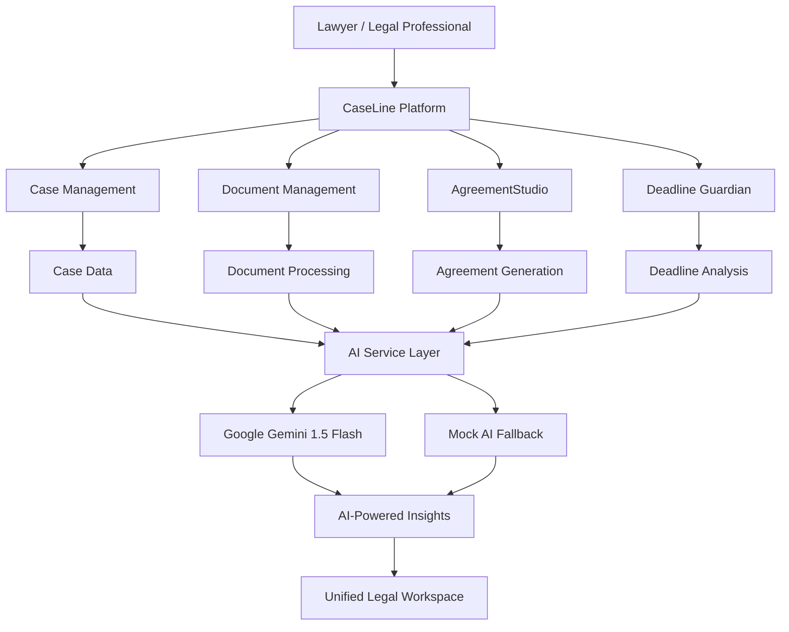

# ⚖️ CaseLine — The Autonomous AI Legal OS

### AI-Powered Legal Case Management & Agreement Generation Platform

[](https://github.com/HackIndiaXYZ/ai-for-lawyers-hackathon-litti-choka)
[](https://nextjs.org/)
[](https://react.dev/)
[](https://www.typescriptlang.org/)
[](https://www.prisma.io/)
[](https://ai.google.dev/)

**CaseLine** is an AI-powered legal operating system designed to simplify litigation management, automate repetitive legal workflows, and help lawyers make better-informed decisions.

Built for the Indian legal ecosystem, CaseLine brings case management, document intelligence, deadline monitoring, bilingual agreement generation, and AI-powered legal assistance into one unified workspace.

---

## 🚨 The Problem

Legal professionals spend a significant amount of time managing administrative tasks instead of focusing on legal strategy and client representation.

Some of the major challenges include:

- **Missed Legal Deadlines:** Important court hearings, filing dates, and statutory limitation periods are often tracked manually.
- **Document Management:** Legal documents are scattered across folders, making information retrieval difficult.
- **Manual Drafting:** Preparing agreements, legal documents, and client updates consumes valuable time.
- **Poor Case Visibility:** Lawyers lack a unified view of case progress, upcoming hearings, and pending tasks.
- **Billing Inefficiency:** Manual time tracking and invoice preparation create unnecessary administrative overhead.

## 💡 Our Solution

CaseLine transforms traditional legal practice management into an intelligent, AI-assisted workflow.

It provides a centralized platform where lawyers can manage cases, organize documents, monitor deadlines, generate legal agreements, and interact with case information using AI.

Our goal is simple:

**Let lawyers focus on law, not paperwork.**

---

## ✨ Key Features

### 1. 🤖 AI-Powered Legal Intelligence

- AI-powered case summarization.
- Smart legal document information extraction.
- Automatic case timeline generation.
- Ask the Case — interact with case documents using natural-language questions.
- AI-generated answers with document and page references.
- AI-assisted legal drafting.
- Hearing preparation briefs.
- AI-powered client communication drafts.

### 2. ⏰ Deadline Guardian

An intelligent deadline monitoring system designed to help legal professionals stay ahead of critical dates.

- Tracks upcoming hearings and statutory deadlines.
- Identifies potentially risky deadlines.
- Assigns risk scores from 0–100.
- Provides recommended next actions.
- Helps monitor filing obligations and limitation-related risks.

### 3. 📄 AgreementStudio

Generate structured legal agreements with AI assistance.

Supported agreement templates include:

- Residential Rent Agreement
- Commercial Rent Agreement
- Property Sale Agreement
- Sale Deed
- Rent Receipt
- Tenant Notice
- Freelance Service Agreement
- Employment Agreement
- Non-Disclosure Agreement (NDA)
- Partnership Deed
- Consultancy Agreement
- Vendor Supply Agreement
- Loan Promissory Note
- Power of Attorney
- General Affidavit

**Additional capabilities:**

- Describe-to-Agreement generation.
- Bilingual English and Hindi agreement support.
- Clause explanation and improvement.
- Missing clause detection.
- Agreement risk and fairness analysis.
- Clause negotiation assistance.
- State-specific legal notes.

### 4. 📁 Smart Document Management

- Centralized legal document storage.
- Case-linked document organization.
- Document version management.
- Document text extraction and chunk storage.
- Structured document information management.

### 5. ⚖️ Case Management

- Create and manage legal cases.
- Organize clients and parties.
- Track case status and priorities.
- Assign case responsibilities.
- Maintain case notes and communications.
- View case-specific information in one workspace.

### 6. 📅 Court Calendar & Hearing Management

- Track upcoming court hearings.
- Maintain hearing schedules.
- Monitor statutory deadlines.
- Organize case-related dates and activities.

### 7. 💰 Billing & Time Tracking

- Track billable and non-billable hours.
- Manage time entries.
- Maintain client invoices.
- Monitor billing information and payments.
- Generate operational reports.

### 8. 👥 Team & Access Management

- Role-based access control.
- Organization-based data management.
- Team member management.
- Task assignment and workload tracking.
- Notifications and audit logs.

---

## 🛠️ Tech Stack

| Category | Technology |
|---|---|
| Frontend | Next.js 16 |
| UI Framework | React 19 |
| Language | TypeScript |
| AI Integration | Google Gemini 1.5 Flash |
| Database | SQLite |
| ORM | Prisma |
| Authentication | NextAuth.js |
| Password Security | bcryptjs |
| Validation | Zod |
| Typography | Inter, Source Serif 4, Noto Sans Devanagari |
| Icons | Lucide React |

---

## 🧠 AI Architecture

CaseLine uses a centralized AI service architecture to manage its AI-powered features.

**AI Engine:** Google Gemini 1.5 Flash

The AI service layer handles:

1. Legal document information extraction.
2. Case summarization.
3. Timeline generation.
4. Context-based case question answering.
5. Deadline risk analysis.
6. Recommended next actions.
7. Client communication generation.
8. Hearing preparation.
9. Agreement generation and analysis.

### AI Fallback Mechanism

CaseLine also includes a mock-response fallback mechanism.

When the Gemini API key is unavailable or an API request fails, supported AI features can return predefined mock responses.

This helps demonstrate the platform's workflows even without an active AI API connection.

---

## 🏗️ Database Architecture

CaseLine uses SQLite with Prisma ORM for relational data management.

The database schema includes models for:

- Organizations
- Users
- Clients
- Cases
- Case Parties
- Documents
- Document Versions
- Document Chunks
- Tasks
- Hearings
- Deadlines
- Time Entries
- Invoices
- Notes
- Communications
- Notifications
- Audit Logs
- AI Insights
- Agreements
- Agreement Parties
- Agreement Versions
- Agreement Signatures
- Saved Parties
- Clause Library Items

---

## 🔄 How CaseLine Works



---

## 🚀 Getting Started

### Prerequisites

- Node.js 20+
- npm
- Google Gemini API key
- Git

### 1. Clone the Repository

```bash
git clone https://github.com/HackIndiaXYZ/ai-for-lawyers-hackathon-litti-choka.git

cd ai-for-lawyers-hackathon-litti-choka
```

### 2. Install Dependencies

```bash
npm install
```

### 3. Configure Environment Variables

Create a `.env` file in the project root.

```env
DATABASE_URL="file:./dev.db"

GEMINI_API_KEY="your_gemini_api_key"

AUTH_SECRET="your_secure_random_secret"
```

### 4. Configure Prisma

```bash
npx prisma generate
npx prisma db push
```

### 5. Run the Development Server

```bash
npm run dev
```

Open your browser and navigate to:

```text
http://localhost:3000
```

**Note:** The current repository snapshot does not include a `package.json`. Restore or add the project's dependency manifest and scripts before running the installation commands above.

---

## 🎯 Target Users

- Independent advocates
- Law firms
- Legal associates
- Corporate legal departments
- Litigation teams
- Legal consultants

---

## 🌍 Impact

CaseLine aims to:

- Reduce repetitive administrative work.
- Improve visibility into case progress.
- Help legal professionals monitor critical deadlines.
- Simplify legal document organization.
- Make agreement drafting more accessible through bilingual support.
- Improve collaboration between legal teams.

By combining AI with legal workflow management, CaseLine aims to make legal operations more organized, efficient, and accessible.

---

## 🔮 Future Roadmap

- Advanced Indian legal research with verified case-law references.
- Integration with Indian court and e-Courts data sources.
- Improved OCR and multilingual document processing.
- Secure cloud-based document storage.
- Digital signing and document verification integrations.
- Advanced legal analytics and predictive insights.
- Enhanced mobile experience.
- More regional Indian language support.

---

## 👨‍💻 Hackathon Project

**Event:** HackIndia 2026  
**Team Name:** Litti Choka  
**Project Name:** CaseLine  
**Category:** AI for Lawyers

**Repository:** https://github.com/HackIndiaXYZ/ai-for-lawyers-hackathon-litti-choka

---

## ⚠️ Disclaimer

CaseLine is an AI-assisted legal productivity and case management platform.

AI-generated content may contain inaccuracies and should always be reviewed and verified by qualified legal professionals before being used in actual legal proceedings or signed agreements.

CaseLine does not replace professional legal judgment or constitute legal advice.

---

## ⭐ Support

If you find this project interesting, consider giving this repository a ⭐ on GitHub.

**CaseLine — Less Paperwork. Smarter Law. Better Outcomes.**


